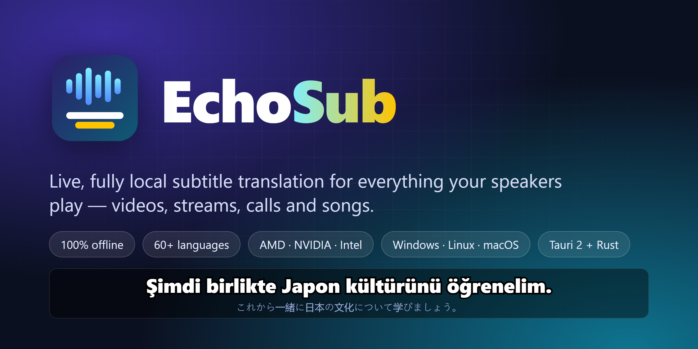
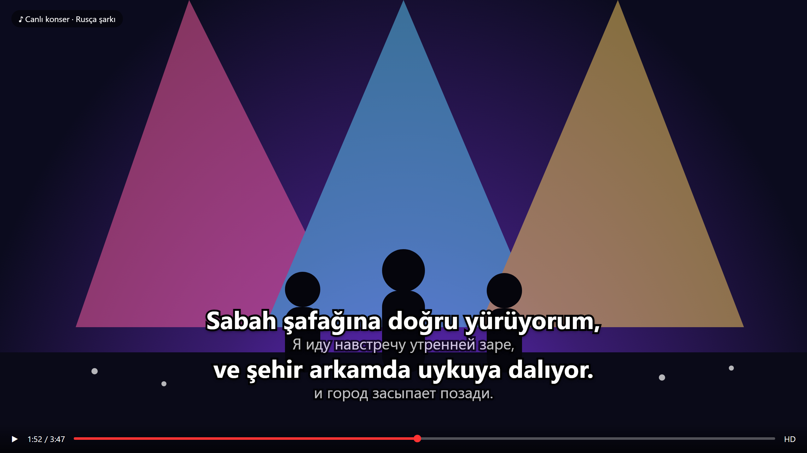
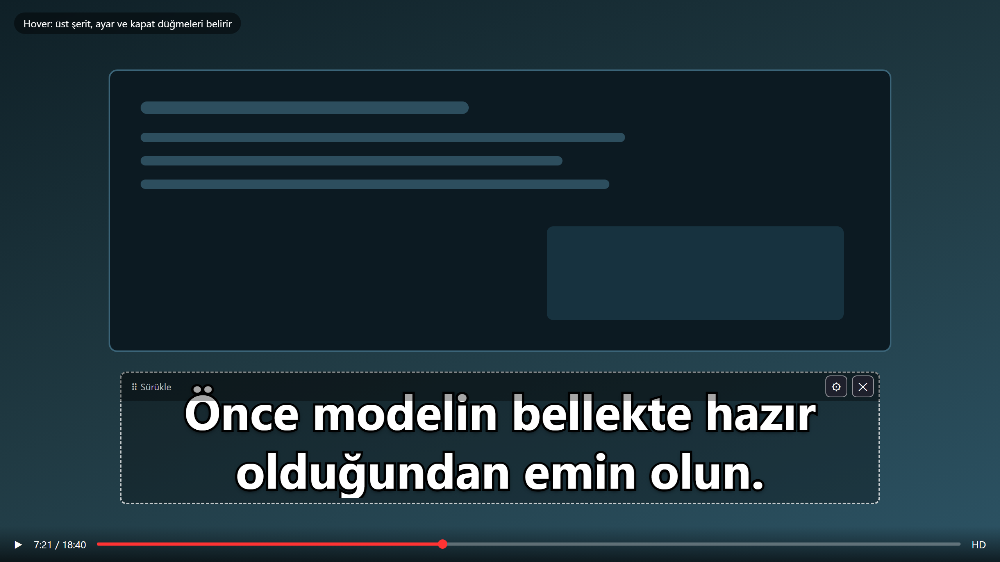
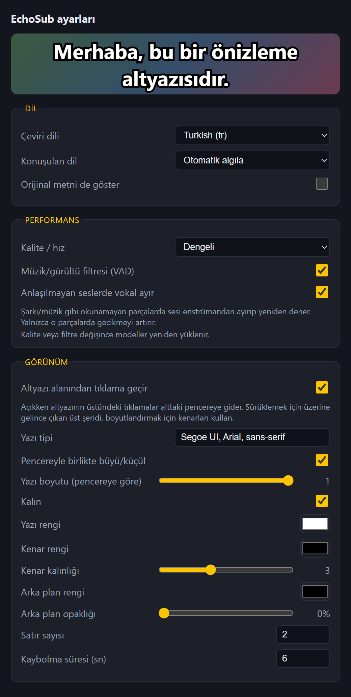
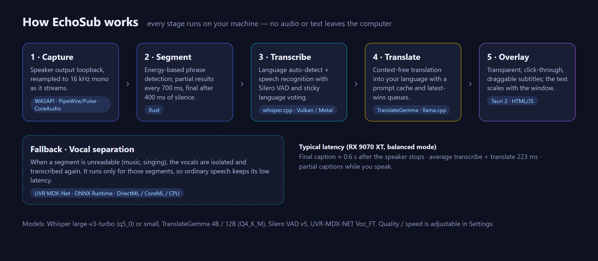

<div align="center">



# EchoSub

**Live subtitles for everything your speakers play, translated on your own machine.**

[](https://github.com/furkiak/EchoSub/actions/workflows/build.yml)
[](https://github.com/furkiak/EchoSub/releases)
[](LICENSE)


[English](README.md) · [Türkçe](README.tr.md)

</div>

EchoSub is a transparent, borderless subtitle overlay that sits at the bottom of your screen. It listens to
whatever comes out of your speakers, detects the spoken language, and shows a translation in the language you
choose. It does this with a Japanese lesson on YouTube, a Russian song, a livestream or a call, and
**nothing ever leaves your computer**: speech recognition and translation both run locally on your GPU (or CPU).

<p align="center">
  
  
</p>

## Highlights

- **Fully local.** whisper.cpp for speech recognition and language detection, TranslateGemma (via llama.cpp) for translation. No accounts, no API keys, no telemetry.
- **Low latency.** Partial captions appear while someone is still speaking; the final caption lands about 0.6 s after they stop.
- **Works on music.** When a segment cannot be read, EchoSub separates the vocals from the instruments and tries again (optional, only for those segments).
- **Any GPU.** Vulkan means AMD, NVIDIA and Intel cards behave the same. Apple Silicon uses Metal. No GPU? It falls back to the CPU, with higher latency.
- **Behaves like a subtitle layer, not a window.** Transparent, always on top, draggable, resizable, and the text grows and shrinks with the window. Clicks on the caption area pass through to the app underneath.
- **Yours to style.** Font, size, colors, outline, background, number of lines, how long captions stay. Preview is live.
- **60+ languages** recognised and selectable as the target, auto-detected or fixed. Translation quality varies by language pair.

## How it looks

| Hover shows a drag strip, settings and close | Settings with live preview |
|---|---|
|  |  |

At rest the overlay is invisible except for the captions. Move the mouse over it and a thin strip appears with a
drag handle, a settings button and a close button. Resize from any edge or corner.

## How it works



1. **Capture:** the default output device is opened in loopback mode and resampled to 16 kHz mono as it streams.
2. **Segment:** an energy-based detector cuts phrases; partial results are emitted every 700 ms and a final one after 400 ms of silence.
3. **Transcribe:** whisper.cpp with Silero VAD detects the language and recognises speech. A short vote over recent segments keeps the language stable.
4. **Translate:** TranslateGemma translates the text. Queues are *latest-wins*, so stale partial results are dropped instead of piling up.
5. **Overlay:** a Tauri window renders the captions. If the translation model is slow, partial captions are skipped so the GPU is spent on final sentences.

Everything runs as local processes talking over `127.0.0.1`. The only network traffic is the one-off model download.

## Requirements

> Measured on one machine only (Windows 11, Radeon RX 9070 XT). The minimums below are estimates from model sizes, not benchmarks.

| | Minimum (usable) | Recommended |
|---|---|---|
| **OS** | Windows 10/11 · Linux with PipeWire or PulseAudio · macOS 14.6+ | Windows 11 |
| **GPU** | Any Vulkan 1.2 GPU with about 4 GB VRAM (AMD, NVIDIA, Intel) or Apple Silicon | 8 GB+ VRAM (16 GB for *quality* mode) |
| **CPU / RAM** | 4 cores, 8 GB RAM (CPU-only works but is much slower) | 8+ cores, 16 GB RAM |
| **Disk** | about 3 GB (*fast*/*balanced*), about 8 GB (*quality*) | SSD |

Disk use per preset: *fast* about 2.8 GB, *balanced* about 3.1 GB, *quality* about 7.9 GB (models only).

## GPU support

All GPU work goes through vendor-neutral back ends, so no vendor-specific build is needed.

| GPU | Speech + translation (whisper.cpp / llama.cpp) | Vocal separation | Status |
|---|---|---|---|
| **AMD** | Vulkan | DirectML (Windows) | **Tested** (RX 9070 XT, Windows 11) |
| **NVIDIA** | Vulkan; optional CUDA build | DirectML (Windows) | Expected to work, **not tested** |
| **Intel** (Arc and integrated Xe/UHD) | Vulkan | DirectML (Windows) | Expected to work, **not tested** |
| **Apple Silicon** | Metal | CoreML | **Not tested** |
| No usable GPU | CPU | CPU | Works, but latency is much higher |

Notes for NVIDIA and Intel users:

- Install the current graphics driver; Vulkan ships with it. `vulkaninfo --summary` should list your GPU.
- NVIDIA owners who want the CUDA path can build it from source: `.\scripts\build-sidecars.ps1 -Backend cuda` (Windows) or `BACKEND=cuda scripts/build-sidecars.sh` (Linux). It needs the CUDA Toolkit, and it has not been measured against Vulkan.
- Laptops with two GPUs (for example an Intel iGPU plus a discrete card) may pick the wrong one. Select it with `GGML_VK_VISIBLE_DEVICES=1` (the index shown by `vulkaninfo`) before starting EchoSub; the servers inherit the variable.
- Integrated GPUs share system RAM, so use the *fast* preset on machines with 8 GB.
- If a GPU back end fails to start, check `runtime/logs/whisper.log` and `llama.log`, or build with `-Backend cpu` to rule the driver out.

We cannot test every card. If yours misbehaves, please open an issue with the two log files and the output of `vulkaninfo --summary`.

## Quick start

### Windows (release build)

1. Download `echosub-<version>-windows-x64.zip` from [Releases](https://github.com/furkiak/EchoSub/releases) and unzip it.
2. Download the models once (choose `fast`, `balanced` or `quality`):
   ```powershell
   .\scripts\download-models.ps1 -Quality balanced
   ```
3. Run `echosub.exe`, then play any audio. The first start loads the models and takes a few seconds; a small status message shows when it is ready.

### Linux / macOS

Release archives are built by CI, but these platforms have not been validated on real hardware yet (see
[Status](#status)). To build from source:

```bash
scripts/build-sidecars.sh            # whisper-server and llama-server (Vulkan on Linux, Metal on macOS)
scripts/download-models.sh balanced  # fast | balanced | quality
cd app && cargo run --release
```

On Linux install `libwebkit2gtk-4.1-dev libgtk-3-dev libasound2-dev libpulse-dev` and a Vulkan driver first.
macOS needs the audio capture permission the first time.

## Using it

| Do this | To get this |
|---|---|
| Hover over the overlay | Drag strip, ⚙ settings, ✕ close |
| Drag the strip | Move the overlay |
| Drag an edge or corner | Resize; text rescales to fit |
| Click on the caption text | The click goes to the window underneath (can be turned off in Settings) |

### Settings

| Group | Options |
|---|---|
| **Language** | Target language, spoken language (auto-detect or fixed), show original text under the translation |
| **Performance** | Quality preset (*fast* / *balanced* / *quality*), VAD music/noise filter, vocal-separation fallback |
| **Appearance** | Click-through, font family, auto-fit or fixed size, bold, text / outline / background colors, outline width, background opacity, line count, hide delay |

Settings are stored in `settings.json` in the OS config folder (`%APPDATA%\com.echosub.app` on Windows,
`~/.config/com.echosub.app` on Linux, `~/Library/Application Support/com.echosub.app` on macOS).
Server logs are written to `runtime/logs`.

### Quality presets

| Preset | Speech model | Translation model | Notes |
|---|---|---|---|
| *fast* | Whisper small (q5_1) | TranslateGemma 4B | Lowest VRAM, lowest accuracy |
| *balanced* | Whisper large-v3-turbo (q5_0) | TranslateGemma 4B | Default |
| *quality* | Whisper large-v3-turbo (q5_0) | TranslateGemma 12B | Best translation, noticeably slower |

## Performance

Measured with *balanced* mode on a Radeon RX 9070 XT (Vulkan), Windows 11:

| What | Result |
|---|---|
| Recognise + translate a finished segment | mean 223 ms, worst 319 ms |
| Speaker stops → final caption | about 0.6 s |
| Vocal separation of 7 s of audio (DirectML) | about 233 ms (only for unreadable segments) |
| *quality* (12B) mode | about 1.9 s on average, up to 3.4 s |

Latency depends on your GPU; slower cards should use *fast*. Songs show captions on final segments only, not as live partials.

## Status

| Platform | State |
|---|---|
| Windows 10/11 | Developed and tested here, including an automated click-through test |
| Linux | Compiles in CI. **Not yet tested on real hardware.** Wayland may not report the cursor position, in which case click-through switches itself off and the overlay stays fully clickable |
| macOS | Compiles in CI. **Not yet tested on real hardware.** Needs macOS 14.6+ for system-audio capture |

Known limitations:

- Mistranslation when the speech is misheard, and unreliable language detection on very short clips.
- The overlay UI is currently in Turkish; the translation target can be any supported language.
- No installer and no in-app model downloader yet.

## Troubleshooting

- **"Çeviri kapalı" / translation off:** the translation model or `llama-server` is missing. Run the download script and check `runtime/logs/llama.log`.
- **No captions at all:** check that something is actually playing on the default output device and that the status message says it is ready. Logs: `runtime/logs/app.log` and `whisper.log`.
- **Captions lag with the *quality* preset:** switch to *balanced* or *fast*, or turn off the vocal-separation fallback.
- **Clicks do not pass through on Linux:** expected on some Wayland compositors; see [Status](#status).
- **Debug the hover zones:** start with the environment variable `ECHOSUB_DEBUG_HOVER=1`.

## Building and testing

```bash
cd app
cargo test --release     # 27 unit tests: settings, languages, resampler, queues, junk/loop filters, WAV, separation helpers
cargo build --release
```

Integration and tooling:

- `tests/click-through/clicktest.ps1` is a Windows test that puts a target window under the overlay and checks that clicks on the captions reach it, that the top strip does not, and that drag and resize still work.
- `tools/screenshots/make-screenshots.ps1` regenerates every image in `docs/images` from the real UI files using headless Edge, with a mocked Tauri API.
- GitHub Actions (`.github/workflows`) runs the tests on Windows, Ubuntu and macOS, and builds release packages when you push a `v*` tag.

Developer helpers (environment variables): `ECHOSUB_HOME` to point at a custom `runtime` folder, `ECHOSUB_DUMP_DIR` to save
final audio segments as WAV files, and `echosub --separate in.wav out.wav model.onnx` to try vocal separation from the command line.

## Project layout

```
app/                Tauri app (Rust backend + plain HTML/JS UI)
  src/              audio capture, pipeline, sidecar control, vocal separation, settings
  ui/               overlay and settings windows
scripts/            build the inference servers, download models
tests/              integration tests
tools/screenshots/  documentation image generator
docs/images/        logo, banner, screenshots, diagram
```

## Roadmap

- First-run model downloader and installers (MSI/NSIS, AppImage/deb, dmg)
- Validate and tune Linux and macOS
- Localised UI
- Live partial captions for sung vocals
- Choose the capture device and GPU in Settings

## Acknowledgements

Built on [whisper.cpp](https://github.com/ggml-org/whisper.cpp), [llama.cpp](https://github.com/ggml-org/llama.cpp),
[TranslateGemma](https://huggingface.co/google/translategemma-4b-it), [Silero VAD](https://github.com/snakers4/silero-vad),
[UVR MDX-Net](https://github.com/TRvlvr/model_repo), [Tauri](https://tauri.app), [cpal](https://github.com/RustAudio/cpal) and
[ONNX Runtime](https://onnxruntime.ai). See [THIRD_PARTY_NOTICES.md](THIRD_PARTY_NOTICES.md) for licenses; the
translation model is under the Gemma terms of use.

## License

[MIT](LICENSE) for EchoSub's own code. Model files keep their own licenses.
