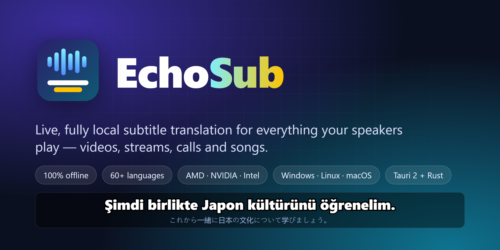
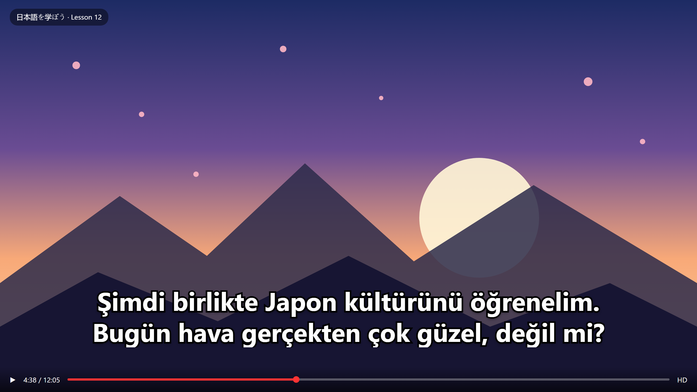
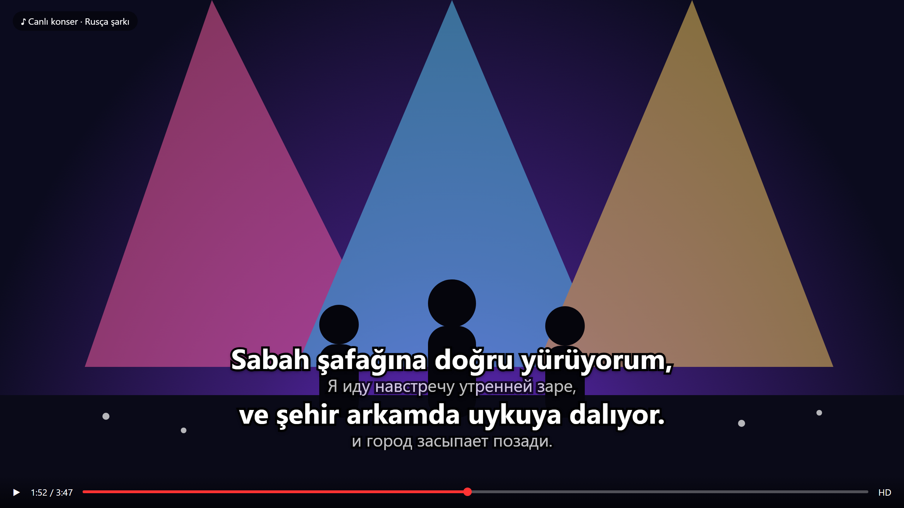
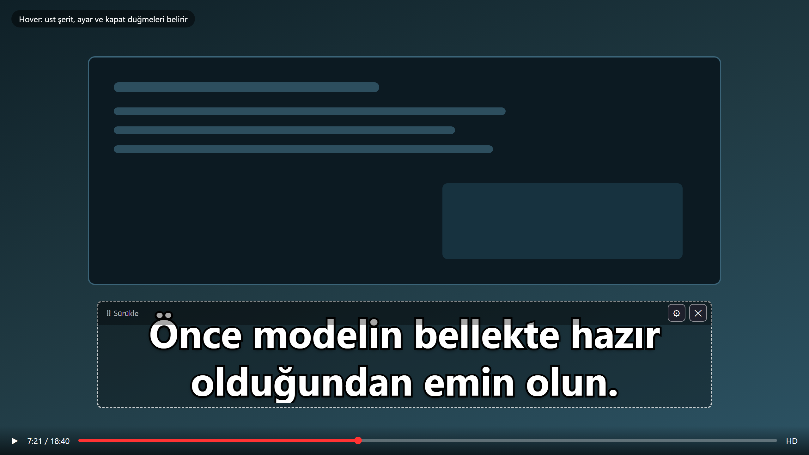
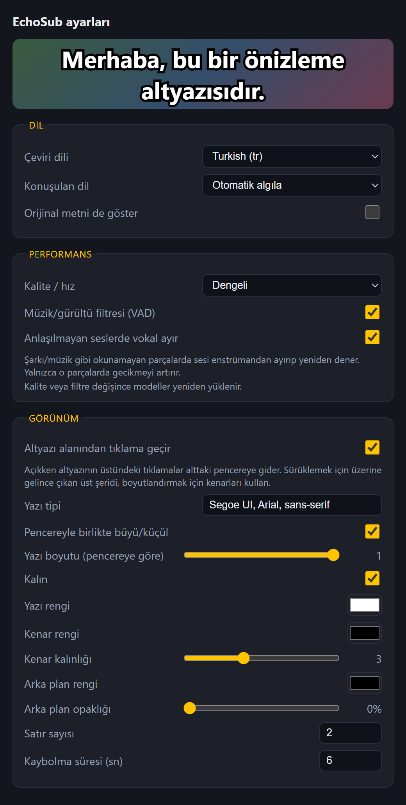
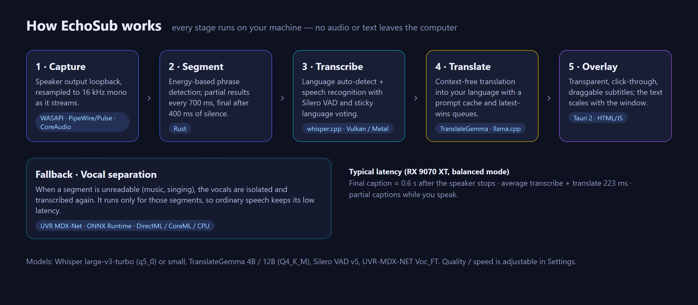
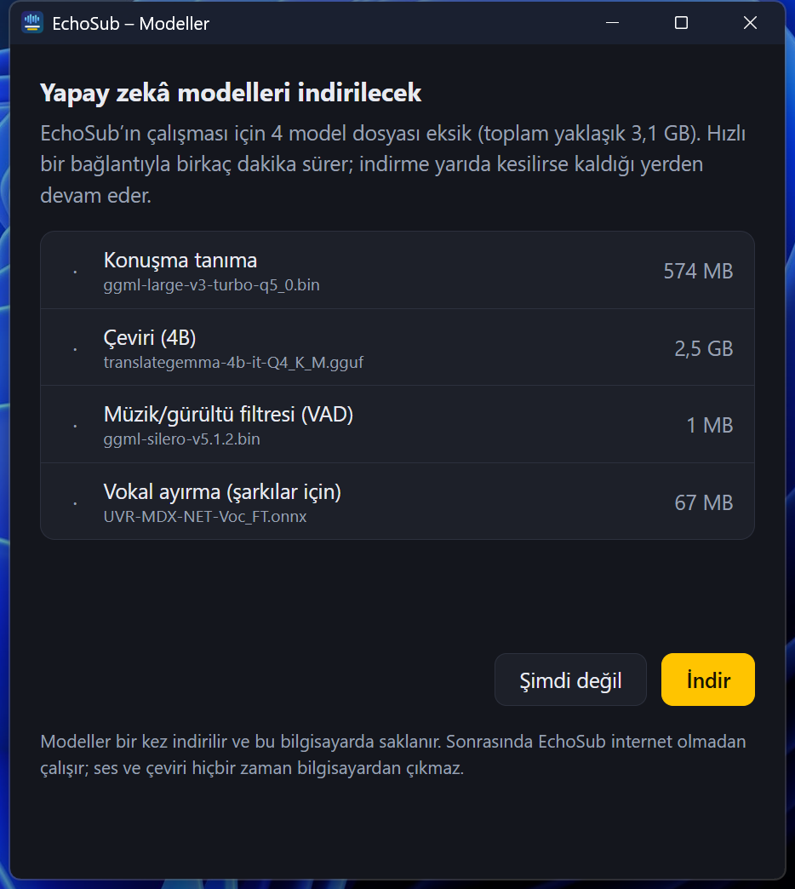

<div align="center">



# EchoSub

**Hoparlöründen çıkan her sese canlı altyazı. Çeviri kendi bilgisayarında yapılır.**

[](https://github.com/furkiak/EchoSub/actions/workflows/build.yml)
[](https://github.com/furkiak/EchoSub/releases)
[](LICENSE)


[English](README.md) · [Türkçe](README.tr.md)

</div>

EchoSub, ekranının altında duran şeffaf ve çerçevesiz bir altyazı katmanıdır. Hoparlörden o an ne geliyorsa
dinler, konuşulan dili algılar ve seçtiğin dilde çevirisini gösterir. YouTube'daki bir Japonca ders, Rusça bir şarkı,
canlı yayın ya da görüntülü görüşme fark etmez. **Hiçbir şey bilgisayarından çıkmaz.** Konuşma tanıma ve çeviri
ekran kartında (ya da işlemcide) yerel olarak çalışır.

<p align="center">
  
  
</p>

## Öne çıkanlar

- **Tamamen yerel.** Konuşma tanıma ve dil algılama için whisper.cpp, çeviri için TranslateGemma (llama.cpp ile). Hesap, API anahtarı ya da telemetri yok.
- **Düşük gecikme.** Biri hâlâ konuşurken kısmi altyazı görünür; konuşma bittikten yaklaşık 0,6 sn sonra son altyazı gelir.
- **Müzikte de çalışır.** Bir parça okunamıyorsa EchoSub vokali enstrümandan ayırıp yeniden dener (isteğe bağlı, yalnızca o parçalarda).
- **Her ekran kartı.** Vulkan sayesinde AMD, NVIDIA ve Intel aynı davranır. Apple Silicon'da Metal kullanılır. Kart yoksa işlemciye düşer, gecikme artar.
- **Pencere değil, altyazı katmanı gibi davranır.** Şeffaf, her zaman üstte, sürüklenir, boyutlanır ve yazı pencereyle birlikte büyür/küçülür. Altyazı alanındaki tıklamalar alttaki uygulamaya geçer.
- **Sen biçimlendirirsin.** Yazı tipi, boyut, renkler, kenar, arka plan, satır sayısı ve kaybolma süresi. Önizleme canlıdır.
- **60'tan fazla dil** tanınır ve hedef olarak seçilebilir; otomatik algılanır ya da sabitlenir. Çeviri kalitesi dil çiftine göre değişir.

## Nasıl görünür

| Üzerine gelince: sürükleme şeridi, ayar ve kapat | Canlı önizlemeli ayarlar |
|---|---|
|  |  |

Normalde yalnızca altyazılar görünür. Fareyi üzerine getirince ince bir şerit çıkar: sürükleme tutamacı, ayar ve
kapat düğmeleri. Boyutlandırmak için herhangi bir kenarı ya da köşeyi çek.

## Nasıl çalışır



1. **Yakalama:** Varsayılan çıkış aygıtı geri-döngü (loopback) modunda açılır ve akarken 16 kHz mono'ya örneklenir.
2. **Bölütleme:** Enerji tabanlı bir algılayıcı cümleleri keser; 700 ms'de bir kısmi, 400 ms sessizlikten sonra son sonuç üretilir.
3. **Tanıma:** whisper.cpp ve Silero VAD dili algılar, konuşmayı yazıya döker. Son birkaç parçanın oylaması dili kararlı tutar.
4. **Çeviri:** TranslateGemma metni çevirir. Kuyruklar *son gelen kazanır* mantığındadır; eskimiş kısmi sonuçlar birikmez, atılır.
5. **Katman:** Bir Tauri penceresi altyazıları çizer. Çeviri yavaşsa kısmi altyazılar atlanır, ekran kartı son cümlelere harcanır.

Her şey `127.0.0.1` üzerinden konuşan yerel süreçlerdir. Tek ağ trafiği, bir defalık model indirmesidir.

## Gereksinimler

> Yalnızca tek makinede ölçüldü (Windows 11, Radeon RX 9070 XT). Aşağıdaki asgari değerler model boyutlarından yapılmış tahmindir, ölçüm değildir.

| | Asgari (kullanılabilir) | Önerilen |
|---|---|---|
| **İşletim sistemi** | Windows 10/11 · PipeWire ya da PulseAudio'lu Linux (glibc 2.39+, örn. Ubuntu 24.04) · macOS 14.6+ | Windows 11 |
| **Ekran kartı** | Yaklaşık 4 GB VRAM'li herhangi bir Vulkan 1.2 kartı (AMD, NVIDIA, Intel) ya da Apple Silicon | 8 GB+ VRAM (*kaliteli* mod için 16 GB) |
| **İşlemci / RAM** | AVX2 destekli 4 çekirdek (2013 sonrası Intel, AMD Zen ve üstü), 8 GB RAM. Yalnızca işlemciyle çalışır ama çok daha yavaştır | 8+ çekirdek, 16 GB RAM |
| **Disk** | Yaklaşık 3 GB (*hızlı*/*dengeli*), yaklaşık 8 GB (*kaliteli*) | SSD |

Ön ayara göre disk kullanımı (yalnızca modeller): *hızlı* ≈ 2,8 GB, *dengeli* ≈ 3,1 GB, *kaliteli* ≈ 7,9 GB.

Windows'ta ayrıca Microsoft Edge WebView2 çalışma zamanı (Windows 11'de ve güncel Windows 10'da hazır gelir) ve `vulkan-1.dll` dosyasını sağlayan bir ekran kartı sürücüsü gerekir. Visual C++ çalışma zamanı pakete dahildir.

## Ekran kartı desteği

Tüm GPU işi üreticiden bağımsız arka uçlardan geçer; üreticiye özel derleme gerekmez.

| Ekran kartı | Konuşma + çeviri (whisper.cpp / llama.cpp) | Vokal ayırma | Durum |
|---|---|---|---|
| **AMD** | Vulkan | DirectML (Windows) | **Test edildi** (RX 9070 XT, Windows 11) |
| **NVIDIA** | Vulkan; isteğe bağlı CUDA derlemesi | DirectML (Windows) | Çalışması beklenir, **test edilmedi** |
| **Intel** (Arc ve tümleşik Xe/UHD) | Vulkan | DirectML (Windows) | Çalışması beklenir, **test edilmedi** |
| **Apple Silicon** | Metal | CoreML | **Test edilmedi** |
| Kullanılabilir GPU yok | CPU | CPU | Çalışır, ama gecikme çok daha yüksektir |

NVIDIA ve Intel kullanıcıları için notlar:

- Güncel ekran kartı sürücüsünü kur; Vulkan onunla gelir. `vulkaninfo --summary` kartını listelemeli.
- CUDA yolunu isteyen NVIDIA sahipleri kaynaktan derleyebilir: `.\scripts\build-sidecars.ps1 -Backend cuda` (Windows) ya da `BACKEND=cuda scripts/build-sidecars.sh` (Linux). CUDA Toolkit gerekir; Vulkan'a göre ölçülmedi.
- İki ekran kartlı dizüstülerde (örneğin Intel tümleşik + ayrık kart) yanlış kart seçilebilir. EchoSub'ı başlatmadan önce `GGML_VK_VISIBLE_DEVICES=1` (`vulkaninfo`'daki sıra numarası) ile seç; sunucular değişkeni devralır.
- Tümleşik GPU'lar sistem RAM'ini paylaşır; 8 GB'lık makinelerde *hızlı* ön ayarı kullan.
- Bir GPU arka ucu açılmazsa `runtime/logs/whisper.log` ve `llama.log` dosyalarına bak ya da sürücüyü elemek için `-Backend cpu` ile derle.

Her kartı test edemeyiz. Kartın sorun çıkarırsa iki günlük dosyası ve `vulkaninfo --summary` çıktısıyla bir issue aç.

## Hızlı başlangıç

### Windows (hazır sürüm)

1. [Releases](https://github.com/furkiak/EchoSub/releases) sayfasından `echosub-<sürüm>-windows-x64.zip` dosyasını indirip aç.
2. `echosub.exe` dosyasını çalıştır. İlk açılışta EchoSub yapay zekâ modellerinin eksik olduğunu fark eder, ne kadar indireceğini (varsayılan *dengeli* ayar için yaklaşık 3,1 GB) söyler ve başlamadan önce sorar. İndirme yarıda kesilirse kaldığı yerden devam eder.

   

3. İndirme bitince modeller kendiliğinden yüklenir (birkaç saniye); bir ses çal, altyazılar görünür. Hazır olunca küçük bir durum mesajı belirir.

Komut satırını tercih edersen ya da internetsiz bir bilgisayarı hazırlayacaksan: `scripts/download-models.ps1 -Quality balanced` (`fast` | `balanced` | `quality`) aynı dosyaları `runtime/models` içine koyar. Kalite ayarını sonradan değiştirince yeni modeller eksikse indirme penceresi yine açılır; *Ayarlar → Modelleri indir / denetle* ile de istediğin an açabilirsin.

EchoSub'ın görev çubuğu simgesi yoktur: ekranın altındaki şeffaf şerittir. Ayarlar ve kapatma için üzerine gel. Zaten açıkken ikinci kez başlatmak bir şey yapmaz.

### Linux / macOS (hazır sürüm)

Bu paketleri CI üretir, ancak henüz gerçek masaüstü donanımında doğrulanmadı ([Durum](#durum)).

Arşivi aç ve `./echosub` komutunu çalıştır; ilk açılış Windows'taki gibidir.

- **Linux**'ta WebKitGTK çalışma zamanı ve bir ses sunucusu gerekir: `sudo apt install libwebkit2gtk-4.1-0 libgtk-3-0 libasound2t64` (Ubuntu 24.04). Ses, varsayılan çıkışın monitör kaynağından PulseAudio ya da PipeWire (`pipewire-pulse`) üzerinden alınır.
- **macOS:** İndirilen paket imzasız olduğu için önce karantina işaretini kaldır: `xattr -dr com.apple.quarantine echosub-*-macos-arm64`. Sistem ilk seferde ses yakalama izni ister.

### Kaynaktan derleme

```bash
scripts/build-sidecars.sh            # whisper-server ve llama-server (Linux'ta Vulkan, macOS'ta Metal)
scripts/download-models.sh balanced  # fast | balanced | quality
cd app && cargo run --release
```

Bunun için gereken Ubuntu 24.04 paketleri: `libwebkit2gtk-4.1-dev libgtk-3-dev libayatana-appindicator3-dev librsvg2-dev libxdo-dev libssl-dev libasound2-dev libvulkan-dev glslc glslang-tools spirv-headers ninja-build cmake` ve bir Vulkan sürücüsü.

Windows'ta `scripts\build-sidecars.ps1` betiğini *x64 Native Tools* kabuğundan çalıştır (C++ bileşenli Visual Studio 2022, CMake, Ninja ve Vulkan SDK gerekir). Betik, whisper.cpp ve llama.cpp'nin denenmiş sabit sürümlerini derler.

## Kullanım

| Şunu yap | Şunu elde et |
|---|---|
| Katmanın üzerine gel | Sürükleme şeridi, ⚙ ayarlar, ✕ kapat |
| Şeridi sürükle | Katmanı taşı |
| Kenar ya da köşeyi sürükle | Boyutlandır; yazı sığacak şekilde yeniden ölçeklenir |
| Altyazı metnine tıkla | Tıklama alttaki pencereye gider (Ayarlar'dan kapatılabilir) |

### Ayarlar

| Grup | Seçenekler |
|---|---|
| **Dil** | Çeviri dili, konuşulan dil (otomatik ya da sabit), çevirinin altında özgün metni göster |
| **Performans** | Kalite ön ayarı (*hızlı* / *dengeli* / *kaliteli*), VAD müzik/gürültü filtresi, vokal ayırma yedeği |
| **Görünüm** | Tıklama geçirme, yazı tipi, otomatik sığdırma ya da sabit boyut, kalın, yazı/kenar/arka plan renkleri, kenar kalınlığı, arka plan opaklığı, satır sayısı, kaybolma süresi |

Ayarlar, işletim sisteminin yapılandırma klasöründeki `settings.json` dosyasında saklanır (Windows'ta
`%APPDATA%\com.echosub.app`, Linux'ta `~/.config/com.echosub.app`, macOS'ta `~/Library/Application Support/com.echosub.app`).
Günlükler `runtime/logs` klasörüne yazılır. Uygulamanın duyduğu ve çevirdiği metinler, `ECHOSUB_LOG_CAPTIONS=1` ile başlatmadıkça buraya kaydedilmez.

### Kalite ön ayarları

| Ön ayar | Konuşma modeli | Çeviri modeli | Not |
|---|---|---|---|
| *hızlı* | Whisper small (q5_1) | TranslateGemma 4B | En az VRAM, en düşük doğruluk |
| *dengeli* | Whisper large-v3-turbo (q5_0) | TranslateGemma 4B | Varsayılan |
| *kaliteli* | Whisper large-v3-turbo (q5_0) | TranslateGemma 12B | En iyi çeviri, belirgin şekilde daha yavaş |

## Performans

*Dengeli* modda, Radeon RX 9070 XT (Vulkan), Windows 11 üzerinde ölçüldü:

| Ne | Sonuç |
|---|---|
| Biten bir parçayı tanıma + çeviri | ortalama 223 ms, en kötü 319 ms |
| Konuşmacı susar → son altyazı | yaklaşık 0,6 sn |
| 7 sn sesin vokal ayrımı (DirectML) | yaklaşık 233 ms (yalnızca okunamayan parçalarda) |
| *kaliteli* (12B) mod | ortalama yaklaşık 1,9 sn, en çok 3,4 sn |

Gecikme ekran kartına bağlıdır; yavaş kartlarda *hızlı* mod önerilir. Şarkılarda altyazı yalnızca son parçalarda görünür, canlı kısmi altyazı yoktur.

Ekran kartı olmadan (i9-14900K'nın 8 çekirdeği, Linux): *hızlı* cümle başına yaklaşık 5-10 sn, *dengeli* 25 sn'nin üstünde sürer; bu, kesintisiz konuşmaya yetişemez. *Hızlı* ayarı kullan. Makine geride kalınca kısmi altyazılar atlanır ve sırada yalnızca en yeni üç cümle bekler; yani altyazı giderek geriye düşmek yerine cümle atlayabilir.

## Durum

| Platform | Durum |
|---|---|
| Windows 10/11 | Burada geliştirildi ve test edildi; otomatik tıklama geçirme testi dahil |
| Linux | Paket, Ubuntu 24.04'te WSLg ve PulseAudio altında işlemciyle baştan sona çalıştırıldı: model indirme, hoparlör sesi yakalama, tanıma, çeviri. **Masaüstü kurulumunda, ekran kartıyla ve PipeWire ile henüz test edilmedi.** Wayland imleç konumunu vermeyebilir; bu durumda tıklama geçirme kendiliğinden kapanır ve katman tamamen tıklanabilir kalır |
| macOS | CI'da derlenip paketleniyor. **Gerçek donanımda henüz test edilmedi.** Sistem sesi yakalama için macOS 14.6+ gerekir |

Bilinen sınırlamalar:

- Konuşma yanlış duyulursa çeviri de yanlış olur; çok kısa kayıtlarda dil algılama güvenilir değildir.
- Arayüz şu an Türkçe; çeviri hedefi desteklenen herhangi bir dil olabilir.
- Henüz kurulum paketi yok (yalnızca taşınabilir arşiv).

## Sorun giderme

- **"Çeviri kapalı":** Çeviri modeli ya da `llama-server` eksik. *Ayarlar → Modelleri indir / denetle* penceresini aç ve `runtime/logs/llama.log` dosyasına bak.
- **"Konuşma sunucusu çöktü":** `runtime/logs/whisper.log` dosyasının son satırlarına bak. Ekran kartı sürücüsünü güncelle; hazır paketler AVX2'siz işlemcileri desteklemez.
- **"… portu başka bir program tarafından kullanılıyor":** 18080 ya da 18081 portunu başka bir program tutuyor; çoğunlukla Linux veya macOS'ta bir çökmeden kalan sunucudur. Onu kapatıp EchoSub'ı yeniden başlat.
- **Hiç altyazı yok:** Varsayılan çıkış aygıtında gerçekten ses çaldığından ve durum mesajının "hazır" dediğinden emin ol. Günlükler: `runtime/logs/app.log` ve `whisper.log`.
- **Kaliteli modda altyazı geriden geliyor:** *Dengeli* ya da *hızlı* moda geç ya da vokal ayırma yedeğini kapat.
- **Linux'ta tıklamalar geçmiyor:** Bazı Wayland ortamlarında beklenen durum; [Durum](#durum) bölümüne bak.
- **Üzerine gelme bölgelerini ayıklamak için:** `ECHOSUB_DEBUG_HOVER=1` ortam değişkeniyle başlat.

## Derleme ve test

```bash
cd app
cargo test --release     # birim testleri: ayarlar, diller, yeniden örnekleyici, kuyruklar, çöp/döngü filtreleri, WAV, ayırma yardımcıları, model indirici (devam, iptal), sunucu denetimi
cargo build --release
```

Entegrasyon ve araçlar:

- `tests/click-through/clicktest.ps1`, katmanın altına bir hedef pencere koyan bir Windows testidir. Altyazılara tıklamanın hedefe ulaştığını, üst şeride tıklamanın ulaşmadığını ve sürükleme/boyutlandırmanın çalıştığını denetler.
- `tools/screenshots/make-screenshots.ps1`, `docs/images` içindeki tüm görselleri gerçek arayüz dosyalarından, sahte bir Tauri API'si ve headless Edge ile yeniden üretir.
- GitHub Actions (`.github/workflows`) testleri Windows, Ubuntu ve macOS'ta çalıştırır; `v*` etiketi gönderince sürüm paketlerini üretir. Her paket yayımlanmadan önce bir denetimden geçer: iki sunucu da paketten açılmalı, Windows ve Linux işlemci kütüphanelerinde AVX-512 kodu olmamalı.

Geliştirici yardımcıları: özel `runtime` klasörü için `ECHOSUB_HOME`, son ses parçalarını WAV olarak kaydetmek için `ECHOSUB_DUMP_DIR`,
altyazı ve süreleri `app.log` dosyasına yazmak için `ECHOSUB_LOG_CAPTIONS=1` ve vokal ayırmayı komut satırından denemek için `echosub --separate girdi.wav cikti.wav model.onnx`.

## Proje yapısı

```
app/                Tauri uygulaması (Rust arka uç + düz HTML/JS arayüz)
  src/              ses yakalama, hat, sunucu yönetimi, model indirici, vokal ayırma, ayarlar
  ui/               katman, ayarlar ve model indirme pencereleri
scripts/            çıkarım sunucularını derle, çevrimdışı model indirme
tests/              entegrasyon testleri
tools/screenshots/  dokümantasyon görsel üretici
docs/images/        logo, banner, ekran görüntüleri, şema
```

## Yol haritası

- Kurulum paketleri (MSI/NSIS, AppImage/deb, dmg)
- Linux ve macOS'u doğrulamak ve iyileştirmek
- Çok dilli arayüz
- Şarkı vokalleri için canlı kısmi altyazı
- Ayarlardan ses aygıtı ve ekran kartı seçimi

## Teşekkürler

[whisper.cpp](https://github.com/ggml-org/whisper.cpp), [llama.cpp](https://github.com/ggml-org/llama.cpp),
[TranslateGemma](https://huggingface.co/google/translategemma-4b-it), [Silero VAD](https://github.com/snakers4/silero-vad),
[UVR MDX-Net](https://github.com/TRvlvr/model_repo), [Tauri](https://tauri.app), [cpal](https://github.com/RustAudio/cpal) ve
[ONNX Runtime](https://onnxruntime.ai) üzerine kuruludur. Lisanslar için [THIRD_PARTY_NOTICES.md](THIRD_PARTY_NOTICES.md) dosyasına bak;
çeviri modeli Gemma kullanım koşullarına tabidir.

## Lisans

EchoSub'ın kendi kodu için [MIT](LICENSE). Model dosyaları kendi lisanslarını korur.
